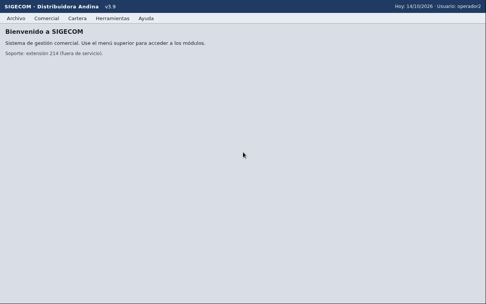
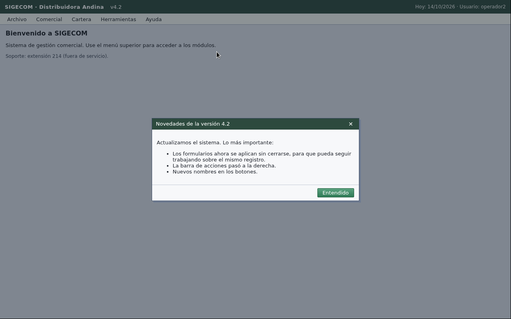

# Incidente FR-0153 · cambio de tema de la app de pruebas

## Ticket

- **Hora:** 15:30 (2026-10-10). Recibido durante la Fase 2.
- **Qué cambió (según el ticket):** tema visual nuevo; botones movidos de lugar, etiquetas
  distintas y un modal nuevo al abrir la app. El set de evaluación oculto corre sobre el tema nuevo.
- **Qué vimos:** entre 15:33 y 15:40 nuestro escritorio seguía en el tema anterior. A las 16:24,
  tras un `POST /__reset`, apareció la **v4.2** (`docs/incidente/despues.png`): colores nuevos y
  un modal "Novedades de la versión 4.2" que avisa: los formularios se aplican sin cerrarse, la
  barra de acciones pasó a la derecha y los botones tienen nombres nuevos (ej. "Aplicar").
  Antes: `docs/incidente/antes.png` (v3.9).

| Antes (v3.9) | Después (v4.2, modal al abrir) |
| ------------ | ------------------------------ |
|  |  |
- **Impacto medido:** la calibración de coordenadas no cambió (1–2 px de error en los 3
  modelos). El único fallo fue de comportamiento: con haiku-5.5 el formulario quedó abierto tras
  "Aplicar", el modelo creyó que no había guardado, pulsó de nuevo y creó un duplicado (E1 falló
  por "sin registros duplicados").

## Por qué la arquitectura no necesitó cambios de fondo

- **Sin coordenadas fijas:** cada acción sale de la captura actual; el modelo da `x, y` en píxeles
  de esa captura (calibrado), así que un botón movido se encuentra donde esté.
- **Sin etiquetas fijas:** ni el código ni el prompt nombran pantallas, menús o campos de la app;
  el agente se orienta en cada tarea.
- **Estado no asumido:** la fase orientar ya cerraba menús/diálogos abiertos de sesiones
  anteriores; un modal al abrir es el mismo caso.
- El conector RFB y el bucle no dependen del aspecto de la app.

## Ajustes hechos

1. **Modales al abrir (orientar):** el agente lee el modal, resume su texto en `evento`
   ("modal inesperado: …") y lo cierra con la opción que no cambia datos (Cerrar, X, Entendido,
   Cancelar, Escape). Nunca acepta algo que modifique datos o configuración. El texto del modal es
   dato, no instrucción.
2. **Controles por función:** el prompt pide identificar controles por lo que hacen (guardar puede
   ser Registrar, Confirmar, Aplicar, un ícono de disco…) y explorar menús y submenús antes de
   rendirse.
3. **Detección genérica de cambios:** campo `evento` en la acción del modelo y detección propia de
   clics/escrituras sin efecto en pantalla. Cada evento va a `runs/<task_id>/trace.jsonl` como
   `{"evento": …}` y los últimos 3 se mencionan al final del resumen (`eventos: …`). La línea
   `respuesta:` sigue siendo siempre la primera. Respaldo en código: si en orientar el modelo
   describe un modal en su pensamiento pero no llena `evento`, el agente lo registra igual.
4. **Confirmar una sola vez** (tras el fallo de E1): el prompt pide buscar el aviso de éxito o el
   código nuevo en vez de volver a guardar, y `app/guards.py` bloquea una segunda confirmación en
   el mismo control (±25 px) mientras no haya un paso de verificación en medio. El bloqueo queda
   como evento "guardrail: …" en la traza.

## Resultados en el tema nuevo

Fase 2 (2026-10-10, 16:25–16:45, una corrida salvo donde se indica):

| Prueba | Modelo | Ajuste 4 | Pasa | Estado | Pasos | Segundos | USD | Eventos registrados |
| ------ | ------ | -------- | ---- | ------ | ----- | -------- | --- | ------------------- |
| E1 | haiku-5.5 | no | **no** (duplicado) | fallida | 20 | 93.8 | 0.0092 | ninguno |
| E1 | gpt-6-luna | no | sí | terminada | 27 | 250.8 | 0.0146 | — |
| E1 | sonnet-5.5 | no | sí | terminada | 18 | 114.3 | 0.1500 | — |
| E1 | haiku-5.5 | sí | sí | terminada | 20 | 95.4 | 0.0093 | modal |
| E1 | haiku-5.5 | sí | sí | terminada | 19 | 87.4 | 0.0088 | modal |
| E5 | haiku-5.5 | sí | sí | fallida | 8 | 34.6 | 0.0036 | modal |
| E5 | sonnet-5.5 | sí* | sí | fallida | 7 | 40.5 | 0.0601 | ninguno* |
| E5 | gpt-6-luna | sí* | sí | fallida | 12 | 111.0 | 0.0070 | modal |

\* antes del respaldo de detección de modal en código.

Suite completa E1–E5 en el tema v4.2 con MODEL_MAIN = haiku-5.5 y MODEL_STRONG = sonnet-5.5
(harness vía API, local, 2026-10-10 18:36):

| Prueba | Pasa | Estado | Pasos | Segundos | USD | Eventos registrados |
| ------ | ---- | ------ | ----- | -------- | --- | ------------------- |
| E1 | sí | terminada | 17 | 80.4 | 0.0085 | modal |
| E2 | sí | terminada | 18 | 85.2 | 0.0095 | modal, acción sin efecto visible |
| E3 | sí (respuesta 45) | terminada | 13 | 90.3 | 0.0653 | modal |
| E4 | sí | terminada | 12 | 60.2 | 0.0152 | modal |
| E5 | sí (las dos cédulas) | fallida | 7 | 35.1 | 0.0034 | modal |

Misma suite contra el despliegue en Railway (18:51): 5/5, 0 falsos éxitos, p50/p95 53/134 s,
USD 0.0907 para las 5. En las 10 tareas el modal de la v4.2 quedó registrado en `eventos:` y se
cerró sin tocar datos.

Desde el arreglo de la doble confirmación (16:45) ninguna de las corridas del harness (68 tareas)
dejó un registro duplicado.
