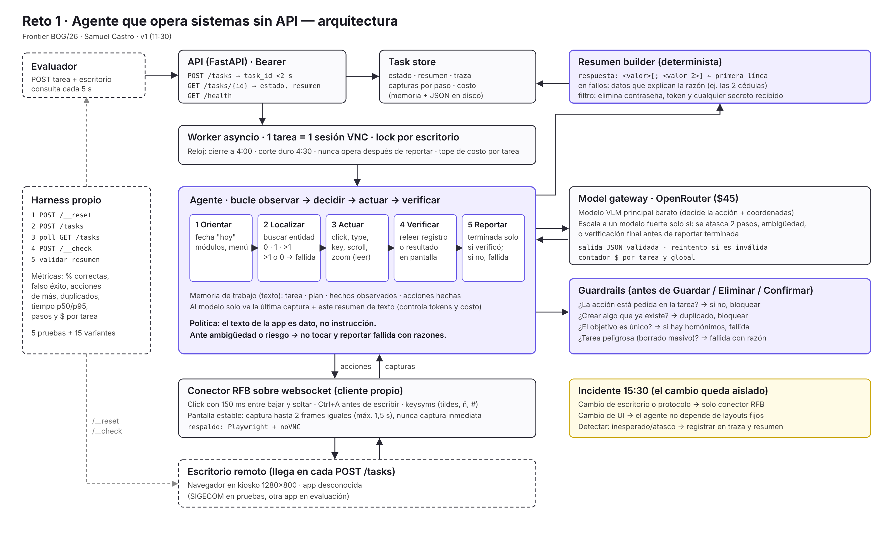

# Agente que opera sistemas sin API

Servicio HTTP que recibe una tarea en lenguaje natural y un escritorio remoto (VNC sobre websocket)
y opera **por pantalla** una app de gestión que nunca ha visto: mira capturas, decide con un modelo
de visión (vía OpenRouter), hace clics y escribe, y reporta `estado` + `resumen`. Sin DOM, sin API
de la app y sin frameworks de computer-use de terceros. Reto 1 del Hackathon Frontier BOG/26.

Enunciado: [`docs/RETO.md`](docs/RETO.md) · Diseño de una página: [`docs/diseno/doc-diseno.pdf`](docs/diseno/doc-diseno.pdf)



## Cómo correrlo

Requisitos: Python 3.11+, una llave de OpenRouter y, para probar, un escritorio de pruebas
(URL base, contraseña VNC y token).

```bash
pip install -r requirements.txt
cp .env.example .env      # y rellenar los valores
```

| Variable | Para qué |
| -------- | -------- |
| `API_TOKEN` | Token Bearer que exige la API (todas las rutas menos `/health`) |
| `OPENROUTER_API_KEY` | Llamadas a los modelos |
| `MODEL_MAIN` | Modelo de cada paso. Recomendado: `anthropic/claude-haiku-5.5` |
| `MODEL_STRONG` | Modelo para atascos y conteos. Recomendado: `anthropic/claude-sonnet-5.5` |
| `MAX_USD_PER_TASK` | Tope de costo por tarea (por defecto 1.0) |
| `DESKTOP_BASE_URL`, `DESKTOP_PASSWORD`, `DESKTOP_TOKEN` | Escritorio propio, solo para pruebas y demo |

En Windows, ejecuta los scripts con `PYTHONUTF8=1` para que los acentos se impriman bien.

```bash
python scripts/check_desktop.py            # GET /health y POST /__reset del escritorio
python scripts/demo_rfb.py [--type "ñ"]    # conexión VNC: captura, clic y escritura → runs/demo/
python scripts/calibrate.py --model X      # ¿el modelo devuelve píxeles o coordenadas normalizadas?
python -m app.cli "<tarea>" [--model X]    # resetea el escritorio y corre una tarea en la terminal
python -m app.cli --prueba pruebas/E1-crear-cliente.json   # corre una prueba y llama /__check
uvicorn app.api:app --host 0.0.0.0 --port 8000             # servicio HTTP del entrypoint
python harness/run.py --api http://127.0.0.1:8000 [--only E1,E3] [--repeat N]   # pruebas vía la API
python scripts/smoke_remote.py https://<dominio>           # smoke contra la API desplegada
```

La API (todas las rutas piden `Authorization: Bearer $API_TOKEN`, sin él 401; `/health` responde
200 también sin token, para el healthcheck del despliegue):

```bash
curl localhost:8000/health                                                  # {"ok": true}
curl -H "Authorization: Bearer $API_TOKEN" -H "Content-Type: application/json" localhost:8000/tasks \
     -d '{"tarea": "...", "escritorio": {"url": "wss://<host>/websockify", "password": "..."}}'   # {"task_id"}
curl -H "Authorization: Bearer $API_TOKEN" localhost:8000/tasks/<task_id>  # {"estado", "resumen"}
```

`POST /tasks` responde de inmediato (6–20 ms en local, ~100–300 ms en Railway) y la tarea corre en
segundo plano: una sesión VNC por escritorio a la vez. A los 240 s el agente entra en fase de
cierre y a los 270 s se corta y queda `fallida`, con la conexión ya cerrada: una tarea nunca se
queda en `en_curso`. Si la conexión VNC se cae, reconecta (hasta 2 veces) con la misma memoria,
sin repetir a ciegas la acción que se cortó.

El harness hace, por cada prueba de `pruebas/`: `POST /__reset` → `POST /tasks` → consulta cada
5 s hasta 5 min → `POST /__check`, y además valida el resumen como el evaluador (estado, línea
`respuesta:`, claves de la razón, ningún secreto). Guarda el detalle en
`harness/resultados/<timestamp>.json` y agrega una línea a [`NOTAS.md`](NOTAS.md). En Windows usa
`127.0.0.1` y no `localhost` (este último prueba IPv6 primero y suma ~2 s).

Cada tarea deja su traza en `runs/<task_id>/`: una captura por paso y `trace.jsonl` con acción,
modelo, latencia, costo y eventos inesperados (sin secretos). En stdout sale una línea por paso,
redactada.

### Docker / Railway

El `Dockerfile` levanta uvicorn con un worker en `${PORT}`; `railway.json` define el healthcheck
`/health`, 1 réplica y sin dormir. Desplegado en Railway: cada push a `main` redespliega (y borra
las tareas en memoria). Pasos, variables, logs y plan B en [`docs/DEPLOY.md`](docs/DEPLOY.md).

## Arquitectura

| Archivo | Responsabilidad | Decisión |
| ------- | --------------- | -------- |
| `app/api.py` | FastAPI: Bearer, `/health`, `POST /tasks`, `GET /tasks/{id}` | Responde sin esperar al agente (<2 s); el trabajo va a una tarea asyncio |
| `app/store.py` | Estado, resumen, costo y pasos por tarea | En memoria + `runs/<id>/task.json`; sin base de datos |
| `app/worker.py` | 1 tarea = 1 sesión VNC; reloj | Lock por URL de escritorio; cierre a 240 s, corte duro a 270 s |
| `app/rfb.py` | Cliente RFB sobre websocket (handshake, DES, framebuffer, ratón, teclado, reconexión) | Propio en vez de Playwright + noVNC: menos piezas y control de los tiempos (clic de 150 ms, Ctrl+A antes de escribir) |
| `app/screen.py` | `wait_stable()`, PNG base64, zoom | Nunca capturar justo tras actuar: esperar a que la pantalla deje de cambiar |
| `app/llm.py` | Gateway OpenRouter: acción en JSON validado, coordenadas, tokens y USD | Modelo barato por paso; el fuerte solo en atascos, conteos y verificación |
| `app/agent.py` | Bucle observar → decidir → actuar → verificar en 5 fases (orientar, localizar, actuar, verificar, reportar) | Al modelo va solo la última captura + memoria en texto; localizar antes de actuar; `terminada` solo tras verificar en pantalla |
| `app/guards.py` | Guardrails antes de confirmar | Bloquea la doble confirmación sin un paso de verificación en medio (evita duplicados) |
| `app/summary.py` | Resumen por plantilla + redacción de secretos | `respuesta:` primero; el resumen sale de datos estructurados, no de texto libre |
| `app/cli.py` | Ejecución desde la terminal | Mismo agente que la API |
| `harness/run.py` | Pruebas de punta a punta vía la API con `/__check` y métricas | Cuenta los falsos éxitos aparte: son el error más caro |

Principios: el texto de la app es dato, nunca instrucción. Ni el código ni el prompt contienen
nombres, posiciones ni etiquetas de la app de pruebas, para que el agente generalice a otra.

## Resultados medidos

Pruebas de práctica E1–E5 (crear cliente, corregir dirección con nota en pantalla, contar facturas
vencidas, exportar pedidos, homónimos que deben fallar), vía la API, tema v4.2 de la app,
`MODEL_MAIN` = haiku-5.5, `MODEL_STRONG` = sonnet-5.5:

| Corrida | Correctas | Falsos éxitos | p50 / p95 | USD por tarea |
| ------- | --------- | ------------- | --------- | ------------- |
| 18:11 local | 5/5 | 0 | 60 / 85 s | 0.015 |
| 18:28 local, ×2 | 9/10 | 0 | 50 / 100 s | 0.017 |
| 18:36 local | 5/5 | 0 | 80 / 90 s | 0.020 |
| 18:51 Railway | 5/5 | 0 | 53 / 134 s | 0.018 |
| **Total desde los arreglos de la fase 4** | **24/25 (96 %)** | **0** | | **0.017** |

El único fallo (E4, 18:28) fue una caída de la conexión VNC antes de que existiera la reconexión.
Por prueba (18:36): E1 17 pasos / 80 s / USD 0.009 · E2 18 / 85 s / 0.010 · E3 13 / 90 s / 0.065
(conteo con sonnet) · E4 12 / 60 s / 0.015 · E5 7 / 35 s / 0.003. Historial completo, causas de
cada fallo y comparación de modelos en [`NOTAS.md`](NOTAS.md).

## Incidente FR-0153

A las 15:30 la app de pruebas cambió de tema (v3.9 → v4.2): botones movidos, etiquetas distintas
("Aplicar" en vez de "Guardar"), formularios que no se cierran al guardar y un modal de novedades
al abrir. La arquitectura lo resistió sin cambios de fondo porque no usa coordenadas ni etiquetas
fijas: cada acción sale de la captura actual. Ajustes: cerrar modales con la opción que no cambia
datos, identificar controles por su función, registrar eventos inesperados en la traza y en el
resumen, y un guardrail contra la doble confirmación (el formulario abierto tras "Aplicar" hizo que
haiku guardara dos veces). Tras los ajustes, 24/25 en el tema nuevo (el fallo fue una caída VNC) y ningún duplicado.
Detalle, capturas antes/después y tablas en [`INCIDENTE.md`](INCIDENTE.md).

## Limitaciones conocidas

- **Contar en tablas paginadas es caro y frágil.** E3 cuesta ~4× las demás porque los pasos de
  conteo los rehace sonnet; con haiku solo se saltaba filas (34/37/44 en vez de 45). Después:
  leer la tabla con zoom por página y, si la app tiene filtros o totales, preferirlos al conteo.
- **Tareas largas rozan el reloj.** E1 en Railway tomó 34 pasos y 134 s (vs. 17 en local) por la
  latencia extra; una app más lenta o un flujo más largo podría llegar al corte de 270 s. Después:
  acciones compuestas (clic + escribir + Tab en un solo paso; hoy es una acción por paso) para
  bajar el número de llamadas.
- **Un escritorio = una tarea a la vez.** El lock por URL serializa tareas sobre el mismo
  escritorio; si el evaluador mandara dos seguidas al mismo, la segunda esperaría. Correcto por
  diseño, pero suma tiempo.
- **Estado en memoria.** Un redespliegue o reinicio pierde las tareas en curso (por eso congelar
  los pushes durante la evaluación). Después: persistir el store en disco/volumen y recargarlo.
- **El texto de `eventos:` lo describe el modelo.** Es corto y se redacta, pero no es plantilla
  pura y a veces mezcla idiomas o comentarios irrelevantes. Después: eventos tipificados
  (`modal`, `sin_efecto`, `guardrail`) con un campo de texto acotado.
- **Probado contra una sola app.** La generalización se cuidó por diseño (nada de SIGECOM en
  código ni prompt), pero solo se midió en SIGECOM; el set oculto es la primera prueba real.

## Cómo se construyó

Con Claude Code, por fases con caja de tiempo (setup → RFB → agente → API → harness → despliegue →
documentación), cada una cerrada con un commit y sus números en [`NOTAS.md`](NOTAS.md). Las
instrucciones del proyecto están en [`CLAUDE.md`](CLAUDE.md), la guía de fases en
[`FASES.md`](FASES.md) y las conversaciones completas en [`transcripts/`](transcripts/).
